# Unified architecture and function codes

MISSY R2 and the linked MISSY analysis page are documented as **one software system**. The current inventory contains **15,071 static functions** across **114 source components**, with **12 detailed facets inside linked MISSY.

The running application remains browser-based real-time PCR simulation and data analysis. F Prime supplies the component, typed-port, command, event, parameter and telemetry modelling conventions used here.

## Codification

- Component: `R2-C0080` identifies a source module.
- Function: `R2-C0080-F00001` identifies a static function in that module.
- Linked MISSY facet: `R2-C0086-S009` identifies an inline analysis section. Its functions retain the parent component's stable function-code namespace.
- Numeric function ID: component number × 65536 + function ordinal, suitable for the model's U32 function-code field.
- Commands use the `CMD` category; events use `EVT`; telemetry has `TLM` channel codes. Category and owner are part of the identifier.

Codes are append-only. Removed identifiers remain reserved and are not recycled. Application and linked MISSY functions carry ID comments; library ownership remains identified and original licence notices are retained. Removing the ID comments from linked MISSY reproduces its prior source exactly. Code bodies and JSON keys have not been translated.

[Search the complete function catalogue](https://mihaiionitabio-alt.github.io/VIRTUALPCR-MISSYR2/architecture.html)

## Combined operator contract

The browser currently dispatches Voice.Submit, Batch.Generate and Missy.Open through coded ports. The model additionally describes linked MISSY package loading, SOP selection, results, charts and review. Its generated dictionary contains both workbench and linked-analysis commands and telemetry. It is a model dictionary, not a claim that a native GDS connection is running.

## All diagrams

All diagrams use compact S-shaped placement. Native fpp-to-layout connection files and fprime-layout JSON remain available; the renderer changes placement only. Purple connections indicate inventory membership. Orange connections indicate source dependencies, load order or logical workflow as noted in the model.

## AllSourceComponents

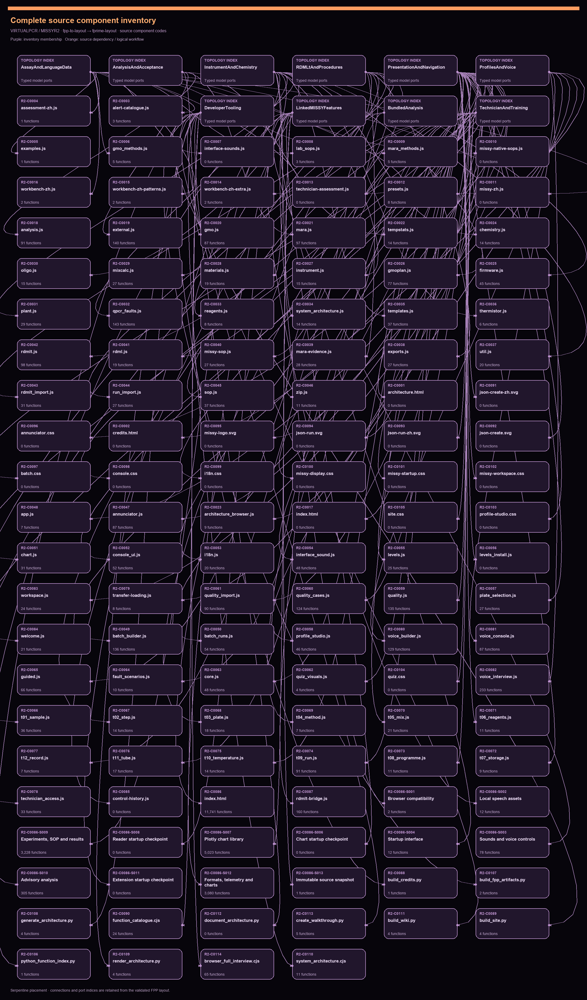

[Open scalable diagram](images/arch-AllSourceComponents.svg)

## AnalysisAndAcceptance

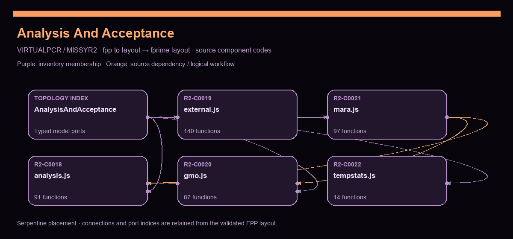

[Open scalable diagram](images/arch-AnalysisAndAcceptance.svg)

## ArchitectureContactSheet

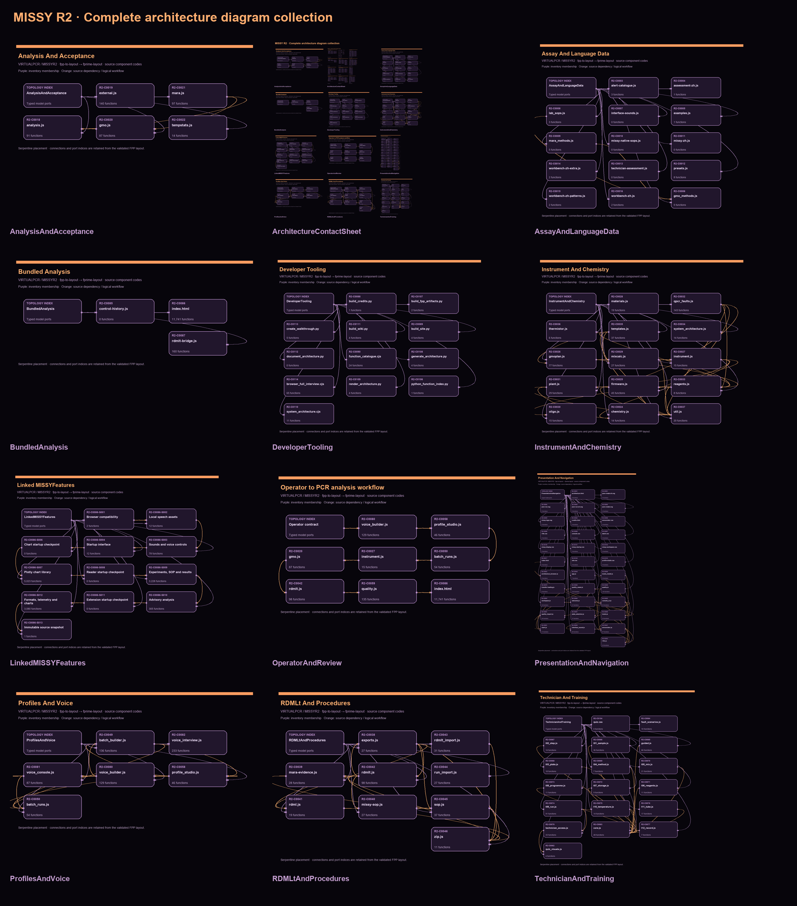

## AssayAndLanguageData

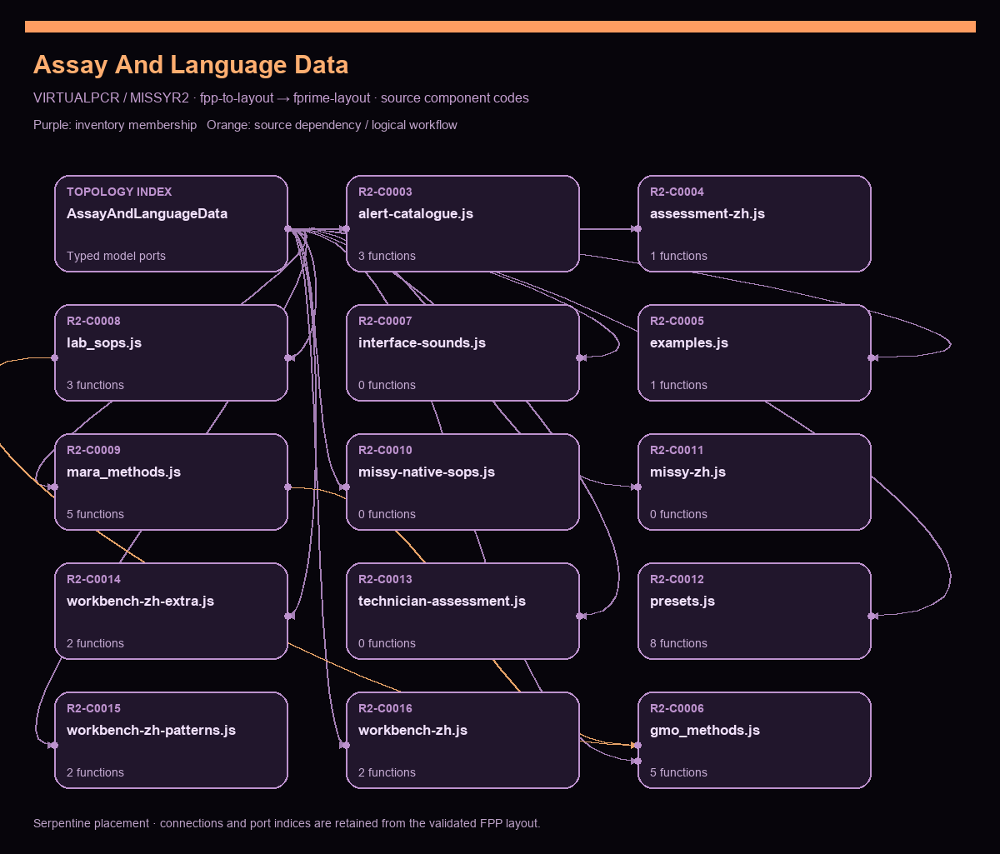

[Open scalable diagram](images/arch-AssayAndLanguageData.svg)

## BundledAnalysis

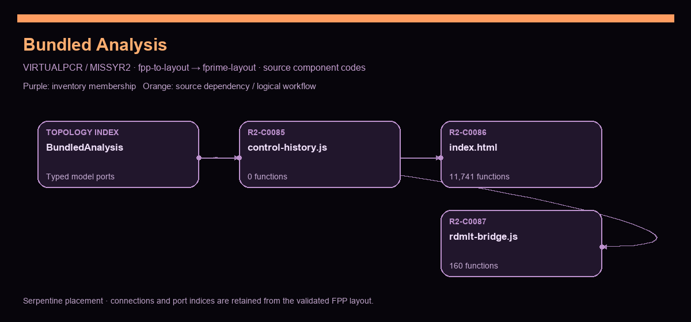

[Open scalable diagram](images/arch-BundledAnalysis.svg)

## DeveloperTooling

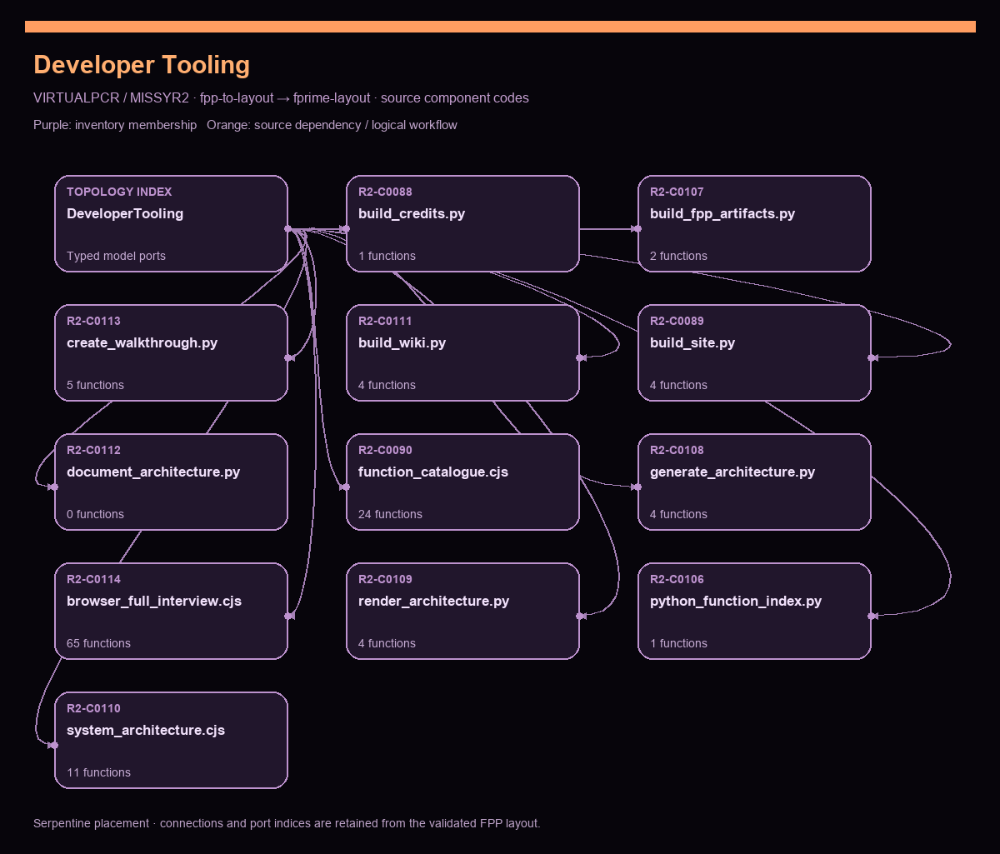

[Open scalable diagram](images/arch-DeveloperTooling.svg)

## InstrumentAndChemistry

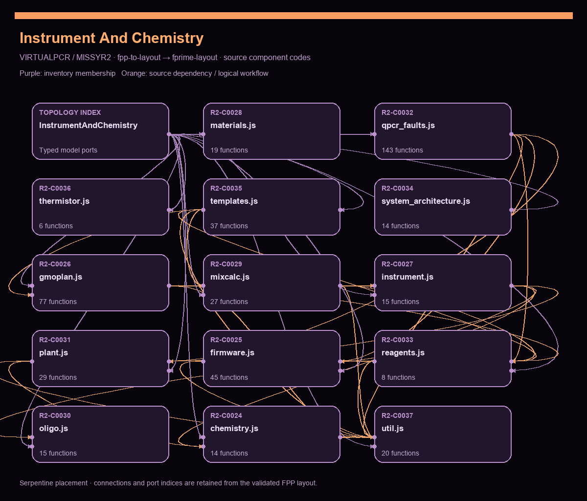

[Open scalable diagram](images/arch-InstrumentAndChemistry.svg)

## LinkedMISSYFeatures

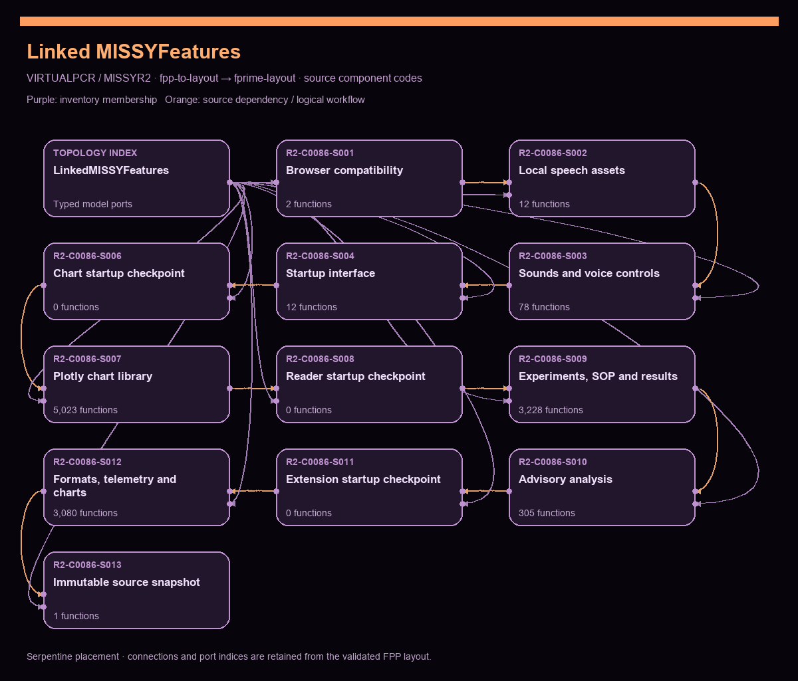

[Open scalable diagram](images/arch-LinkedMISSYFeatures.svg)

## OperatorAndReview

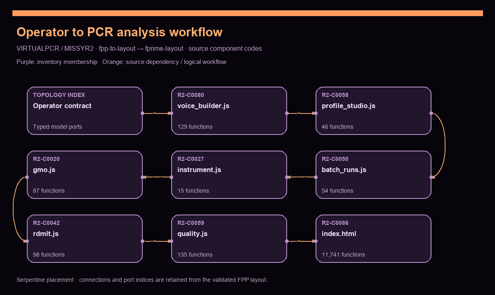

[Open scalable diagram](images/arch-OperatorAndReview.svg)

## PresentationAndNavigation

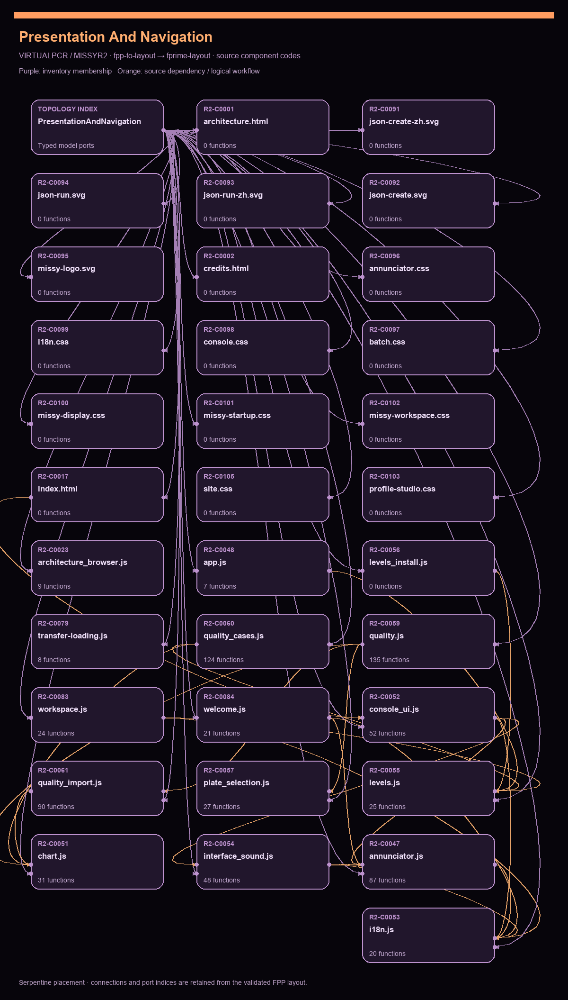

[Open scalable diagram](images/arch-PresentationAndNavigation.svg)

## ProfilesAndVoice

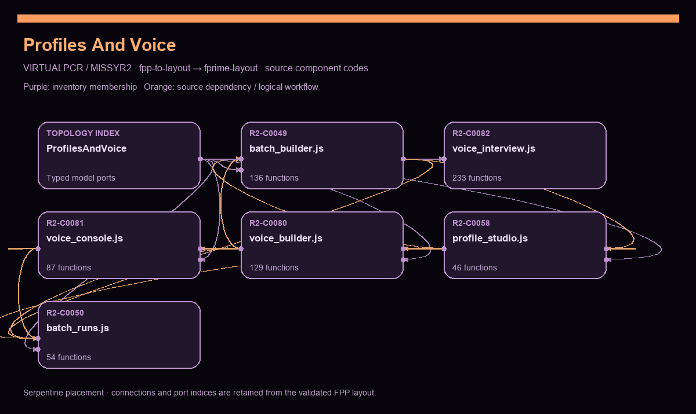

[Open scalable diagram](images/arch-ProfilesAndVoice.svg)

## RDMLtAndProcedures

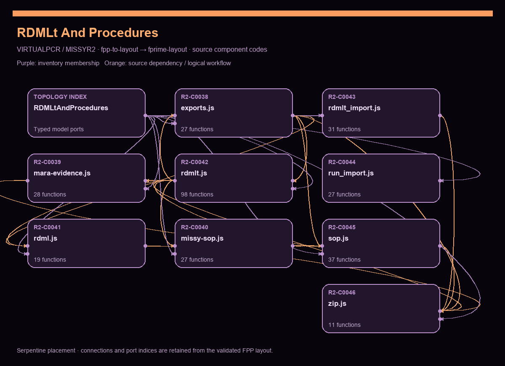

[Open scalable diagram](images/arch-RDMLtAndProcedures.svg)

## TechnicianAndTraining

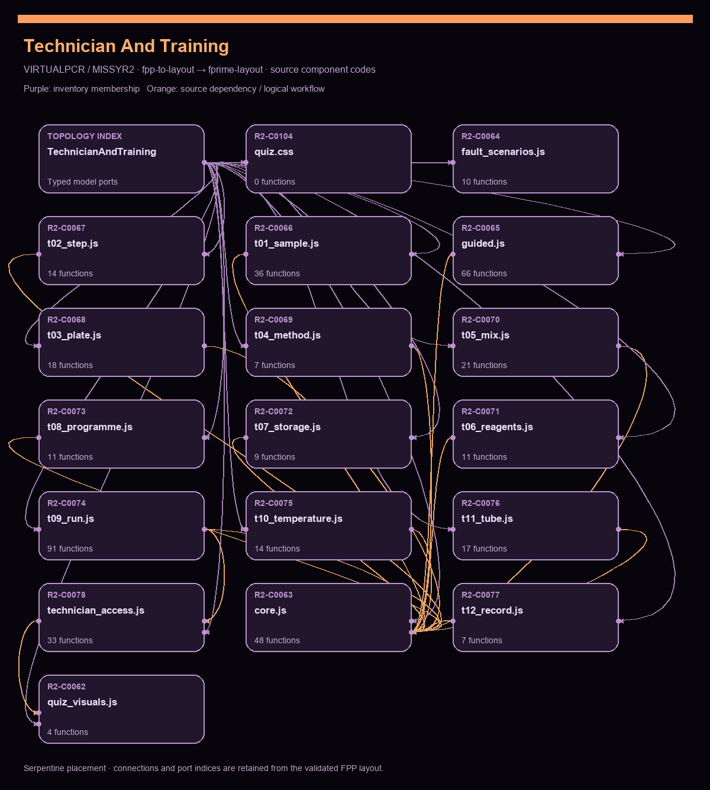

[Open scalable diagram](images/arch-TechnicianAndTraining.svg)

