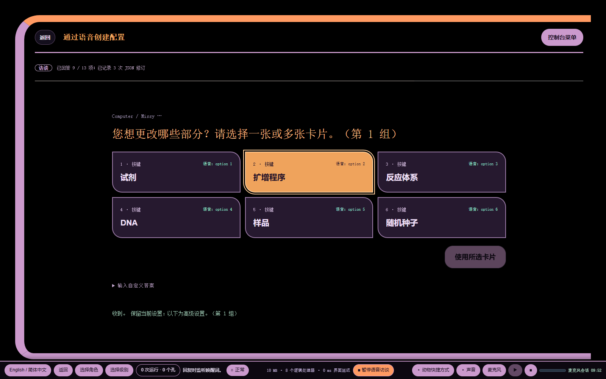
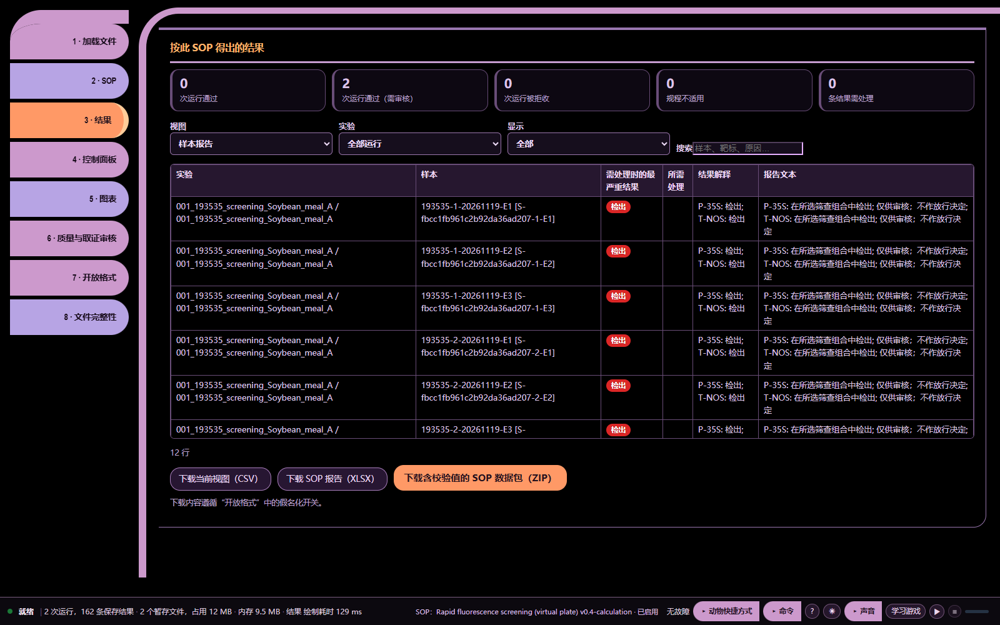

# 中文入门

MISSY R2 是用于实时 PCR 教学、虚拟实验和数据分析练习的浏览器工作台。所有实验读数均为模拟数据。

1. 在首屏切换到简体中文。
2. 点击创建 JSON 配置，选择辅助式、可视积木或语音访谈。
3. 点击底栏的开始语音访谈，启动麦克风会话。默认时长为 10 分钟。
4. 点击编号卡片，或说 **Computer option two**。
5. 多选问题可选择多张卡片，再点击使用所选卡片；也可说 **Computer option one and option two**。
6. 说 **Computer** 或 **Missy** 可打断朗读，听到唤醒音后在 10 秒内给出命令。
7. 只有说 **Computer list options** 才会朗读全部当前选项。
8. 审核完整配置，确认注意事项，然后确认生成并启动运行。
9. 在质量管理中勾选记录，打开 MISSY 检查 RDMLt、SOP、结果和遥测图。

卡片上的试剂、扩增程序、反应体系、DNA、样品、随机种子为显示名称。JSON 中的 `reagents`、`programme`、`mix`、`dna`、`samples`、`seed` 保持英文，以保证配置兼容性。

目前语音识别使用浏览器安装的英语本地语音包；中文界面支持中文问题和中文本地语音输出，语音命令及唤醒词示例仍使用英语。浏览器权限和本地中文发音声音需分别具备。保存的历史仅包含已接受的 JSON 配置，不保存原始识别文字。

