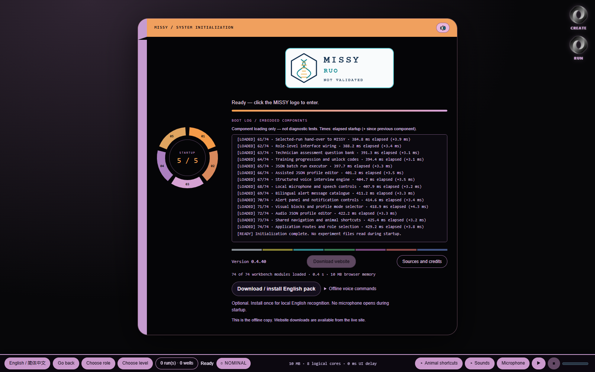

# MISSY R2 documentation

[Live workbench](https://mihaiionitabio-alt.github.io/VIRTUALPCR-MISSYR2/) · [Source code](https://github.com/mihaiionitabio-alt/VIRTUALPCR-MISSYR2) · [中文入门](Chinese-quick-start.md)

MISSY R2 is a browser-based virtual real-time PCR workbench for training, configurable experiments and data-analysis practice. It generates simulated amplification records and instrument telemetry, packages them as RDMLt, and opens selected runs in the bundled MISSY analysis tools. Research and teaching software under development; not validated for laboratory decisions.

- [Voice console](Voice-console.md): one question at a time, large answer cards, wake-word interruption and JSON-only history.
- [JSON profiles](JSON-profiles.md): assisted, visual and audio builders; reusable multi-group run configurations.
- [MISSY review](MISSY-review.md): RDMLt files, procedures, result evidence and telemetry charts.
- [Screen guide](Screen-guide.md): selected screenshots with captions.
- [Architecture and codes](Architecture.md): component/function identifiers and all topology images.
- [Generated artifacts](Generated-artifacts.md): dictionaries, AST, layouts and test scaffolds.
- [Verification and limits](Verification.md): what was actually checked.
- [Developer reproduction](Reproduction.md): regenerate the inventory and models.

