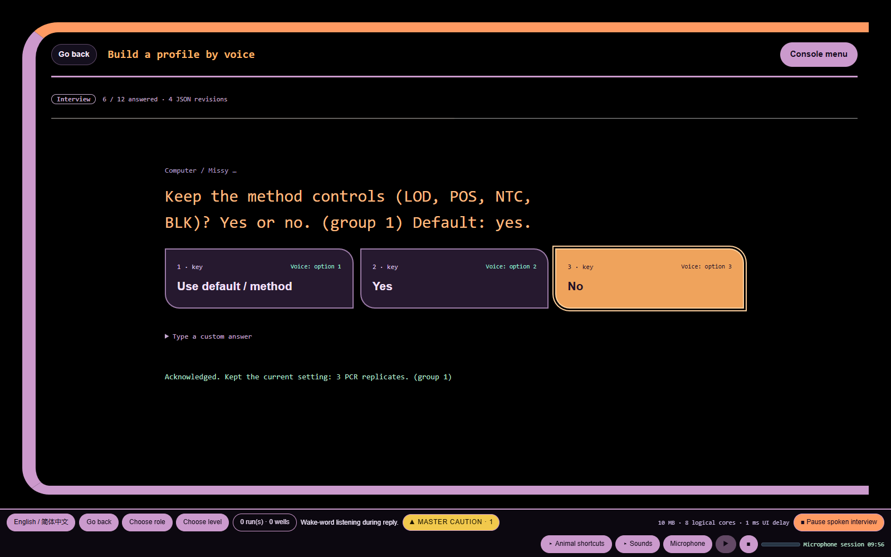
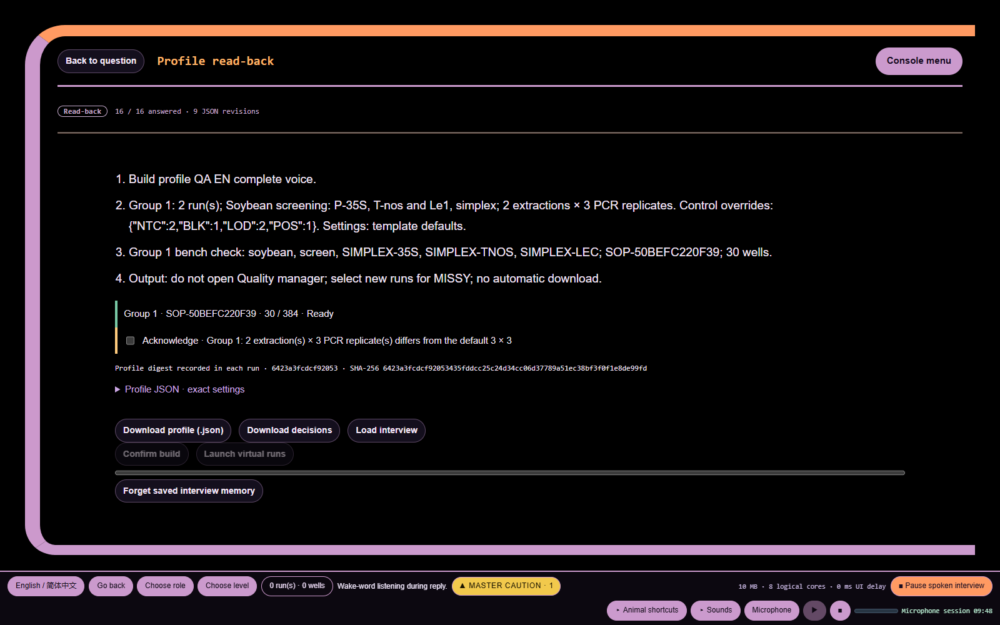

# JSON run profiles

The first page provides Create and Run shortcuts. Create offers Assisted, Visual blocks and Audio interview; all three work on the same profile draft. Download a profile as JSON to reuse it. Running JSON produces the same virtual run records as the Technician bench.

A profile contains one or more run groups. Each group has its own template, repeat count, samples, extraction and PCR replicate counts, controls, optional settings and error scenario. A group repeated five times and another group repeated three times produces eight runs. Every group is checked before execution starts.



Extraction and replicate counts are built-in plate-design settings. The plate has 384 wells; available sample capacity depends on the chosen assays, counts and controls. The preview reports actual capacity and procedure warnings. Do not assume that removing a required control makes it optional: procedure acceptance minima remain enforced.

Example profile syntax:

```json
{"format":"missy-r2-batch/1","name":"Comparison","runs":[{"template":"TPL-BUILTIN-SIMPLEX-SC-SOY","repeat":2,"design":{"extractions":2,"replicates":3,"controlCounts":{"LOD":2,"NTC":2,"BLK":1,"POS":1}}}],"output":{"openQuality":false,"selectForMissy":true,"downloadRdmltZip":false}}
```

Review the complete profile, acknowledge its displayed cautions, confirm the build, then launch within the indicated window. Changed settings disarm the prior confirmation. Stop preserves the run already in progress.


