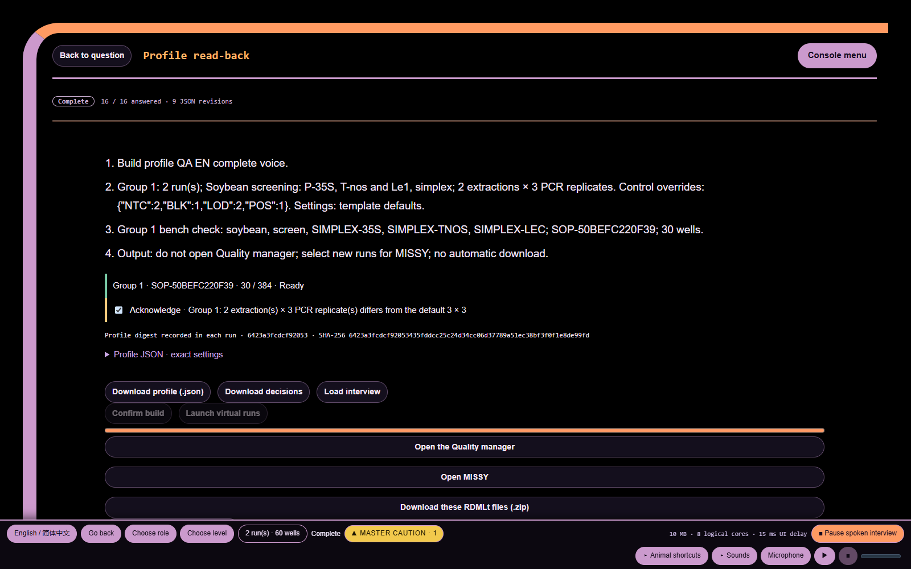
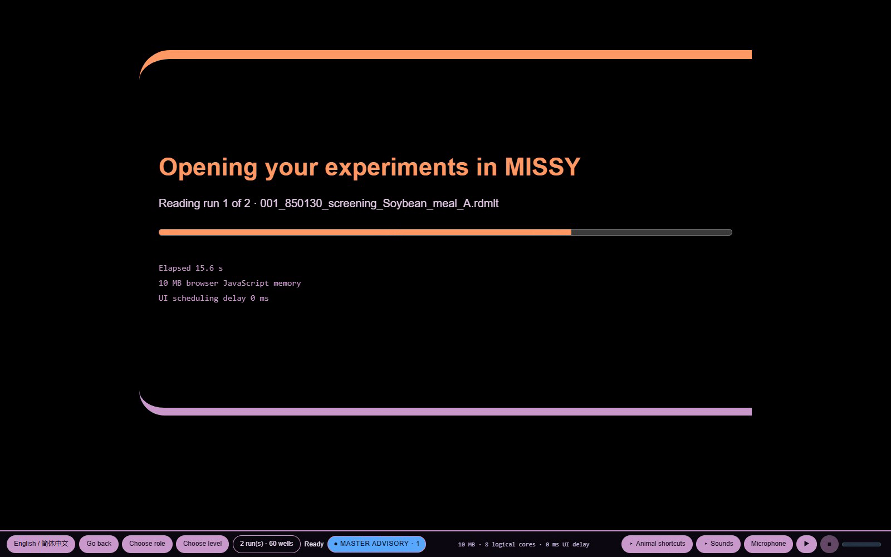
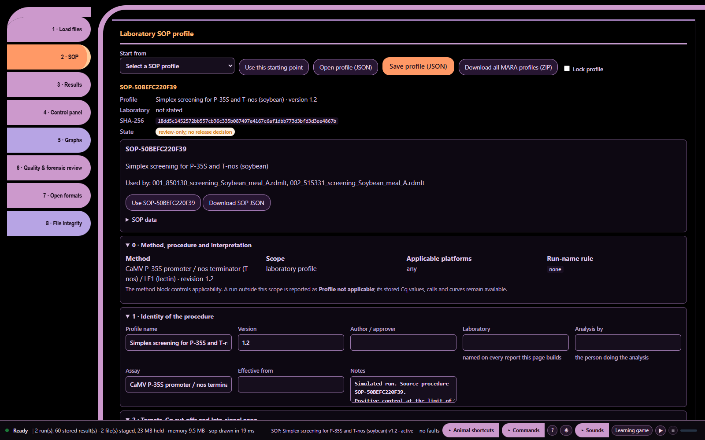
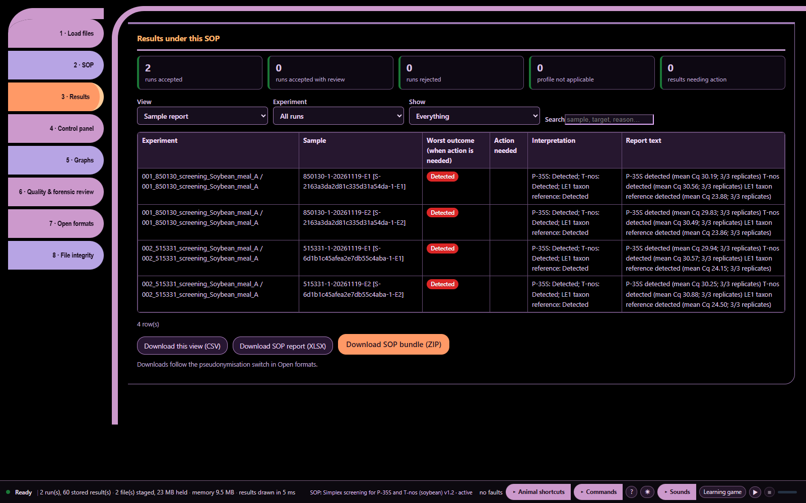
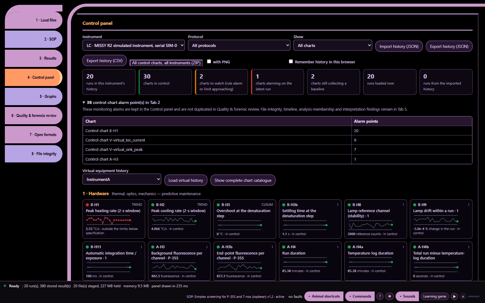

# Open generated runs in MISSY

Quality manager shows the stored runs. Select the runs to open using the checklist; each entry shows its procedure ID. Select all / Clear all change the selection. Open MISSY loads the selected raw packages and their procedure information, with a full-screen loading display while transfer and import complete.

In MISSY, use the established pages:

- Load an experiment: the original raw files have the `.rdmlt` extension.
- SOP: inspect the procedure name, settings and evidence. Identical procedure definitions are shared; different procedures remain distinct.
- Results: inspect sample and assay rows and reasons for review.
- Control panel: inspect instrument telemetry and control-chart histories.

Opening runs with different procedures produces a full-page warning. Review the selected procedure before interpreting results. Workbench-generated records are simulations, and injected scenarios remain identified as deliberate.

Charts may contain points while still collecting a baseline. The current chart rules generally need about 20 compatible runs before baseline alarms become meaningful. Two loaded experiments are not a mature control-chart history. Run durations and thermal timestamps refer to simulated instrument time; the animated display uses accelerated playback. Amplification acquisitions occur at integer cycle numbers.
