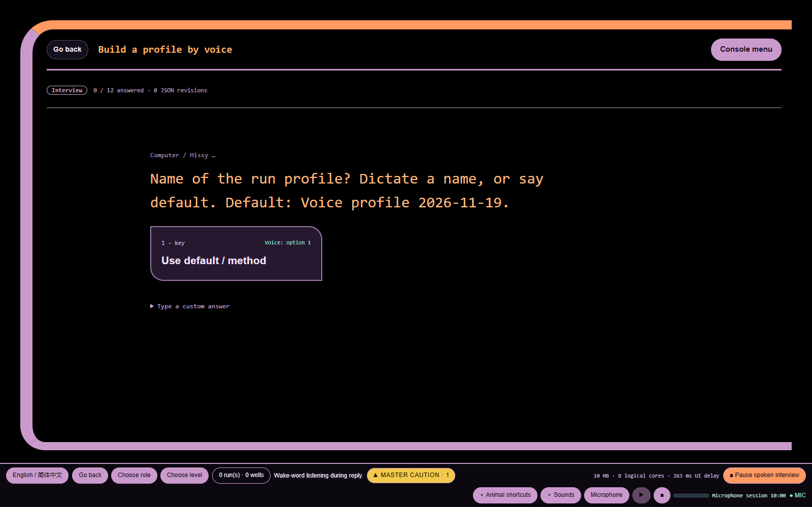
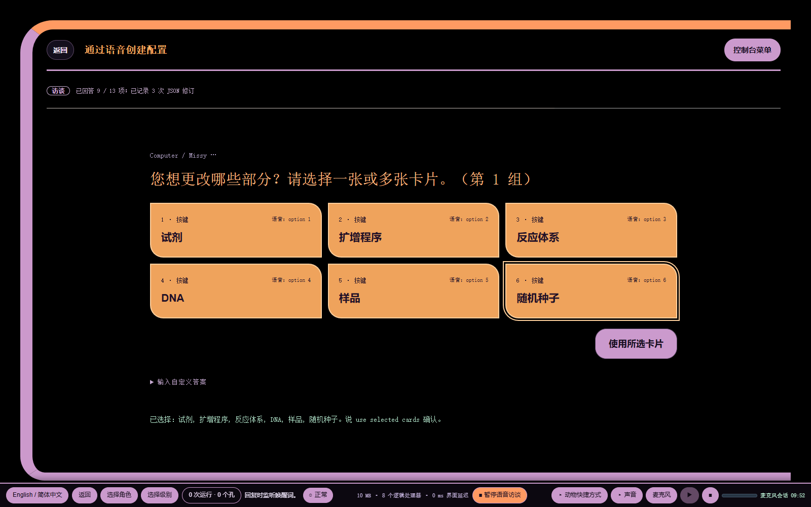

# Voice console

Open Create JSON profile on the first page and choose Audio interview. Start spoken interview in the bottom bar. This starts the default 10-minute microphone session; the browser may ask for microphone permission. Install/check the on-device English recognition pack when requested.

## Answer a question

Click a numbered card, use keys 1–6 outside the custom text field, or say **Computer option two**. The number refers to the card currently shown, not necessarily its numeric value. The reply states the value applied. Use Next cards / Previous cards to browse; browsing changes no configuration.

For questions allowing several sections, select multiple cards and choose **Use selected cards**. By voice, **Computer option one and option two** applies both together; a single numbered option toggles that selection. **Computer use selected cards** confirms the current selection.

## Interrupt reading

Say **Computer** or **Missy** while the reply is being read. Reading stops and the native MISSY wake cue plays. You may give the command in the same phrase, or after the cue within 10 seconds. Only **Computer list options** reads the card list. A navigation cue plays when the view changes. Other interface sounds pause recognition; a session resumes afterward if still active.

- Computer next cards / Computer previous cards
- Computer back / Computer undo / Computer say again
- Computer read back / Computer where am I
- Computer confirm build / Computer launch
- Computer stop, or the bottom-bar Stop button

During generation, Stop finishes and files the current run before stopping the remaining batch. The microphone is closed during generation.

## Languages and privacy

English and Simplified Chinese display labels and local speech output are supported. **Recognition currently uses the installed English pack**, so the wake words and spoken command examples remain English in the Chinese interface. Recognition packs do not install a local speaking voice.

The saved history contains accepted JSON settings and revisions, not raw recognition transcripts. Custom names supplied as profile settings remain part of the profile. Sound settings, session duration, microphone meter and Stop remain available in the bottom bar.
